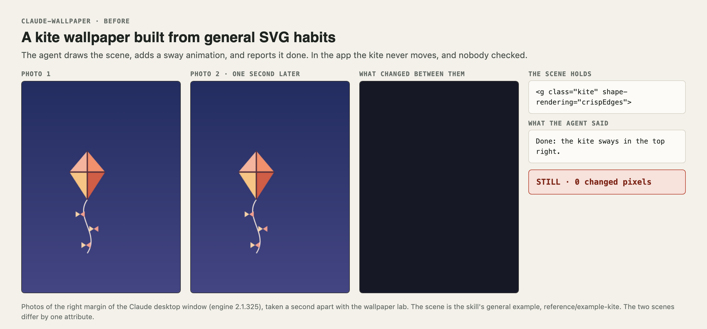
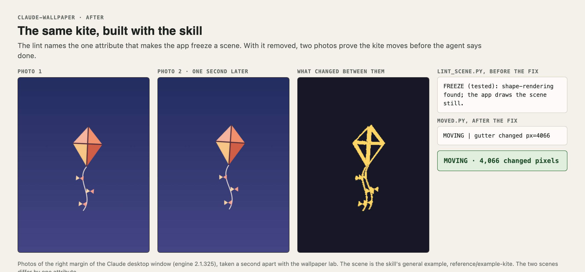

# claude-wallpaper

Animated wallpapers for the Claude desktop app that actually move, with photos to prove it.

## Problem

You ask your agent for an animated background for the Claude desktop app. It draws a nice SVG, adds a few
animations, and says it's done. In the app, nothing moves. Or the window turns white. Or the wallpaper shows up and
then vanishes after your next message.

The app has rules that aren't written down. One rendering hint anywhere in the drawing freezes the whole scene.
Pictures don't draw at all. Another theme plugin can overwrite yours on every message. And your agent can't see the
window, so every fix becomes "try it and tell me", with one reload per guess.

## What it does

- **Gives the agent the app's rules, each with how it's known**: tested in the app, reported by another author, or
  only a risk.
- **Lints a scene before it reaches the app** and fails the build on a known freeze trigger.
- **Adds a live test switch.** A small mod shows any SVG as the backdrop within about two seconds, with no reload,
  so twenty tests take minutes instead of twenty turns.
- **Proves motion with photos.** Two photos of the window a second apart go in; `MOVING` or `STILL` comes out,
  with a pixel count.
- **Starts from a control.** A known-moving scene is tested first, so "the app can't animate" is ruled in or out
  before anyone touches the drawing.

```text
$ python3 scripts/lint_scene.py kite-frozen.svg
FREEZE (tested): shape-rendering found; the app draws the scene still. Remove it everywhere (rule or attribute).
FAIL: the app would not animate or draw this scene

$ moved.py photo-1.png photo-2.png
MOVING | gutter changed px=4066 | gutter colour=[90, 82, 139]
```

## Before / after

The same kite wallpaper, without and with the skill. Each picture holds two real photos of the Claude desktop
window's right margin, taken a second apart, and the pixels that changed between them. The two scenes differ by one
attribute. Sources are in [`examples/`](examples/); the scene is [`reference/example-kite`](reference/example-kite/).

Before: the agent reports it done, and the kite never moves.



After: the lint names the attribute, and the photos show the kite swaying.



## How to install

Paste this into Claude Code (or any coding agent):

```text
Install the claude-wallpaper skill globally from https://github.com/ussumant/useful-agent-skills and read its README
```

Or with `npx`:

```sh
npx skills add ussumant/useful-agent-skills --skill claude-wallpaper --global --yes
```

It needs:

- Claude Code running in a version of the Claude desktop app that draws a mod's backdrop.
- `uv` for the photo check, which uses `pillow` and `numpy`. The other scripts are python3 standard library and zsh.
- A way for the agent to photograph one window. The skill's steps use
  [cua-driver](https://github.com/trycua/cua) on macOS. Any tool that saves a PNG of a single window works.

## How to use

Ask for a wallpaper, or say what's wrong with one:

```text
make me an animated wallpaper of a lighthouse for the Claude app
my wallpaper is there but nothing moves
the background disappears after I send a message
```

The agent then lints the scene, installs the test switch, tests the control, tests your scene, and reports the
photo verdicts. The commands it runs:

```text
scripts/lint_scene.py <scene.svg | hooks/scene.ts>     known freeze triggers, before the app sees them
scripts/install_lab.sh <mods folder> <lab folder>      put the live test switch into this session
scripts/show.sh <lab folder> <scene.svg> <word>        show a scene now; --off puts the app's look back
scripts/moved.py a.png b.png [--probe]                 two photos in, MOVING / STILL out
```

## What's inside

- [`SKILL.md`](SKILL.md): the rules, the workflow, how to photograph the window politely, and how to bisect a
  frozen scene.
- [`scripts/`](scripts/): the lint, the test-switch installer, the scene switcher and the photo check.
- [`reference/lab-mod/`](reference/lab-mod/): the test switch itself, a three-file mod.
- [`reference/scenes/`](reference/scenes/): a known-moving control, a minimal mover, the yellow probe square and a
  deliberately frozen case, with what each did in the app.
- [`reference/example-kite/`](reference/example-kite/): a small general scene and the script that generates it.
- [`reference/hold-the-look.md`](reference/hold-the-look.md): what to do when another theme plugin overwrites yours.

## Honest caveats

- Tested on one build of the app (engine 2.1.325) on macOS. The mod API is early access, so the rules can change.
  Run the control before trusting any of them.
- `moved.py` only looks at the side margins, where the conversation doesn't draw. A wallpaper that moves only
  behind the chat column reads `STILL`. Keep a moving subject in a margin, or add the probe square.
- Switching the test switch off clears whichever theme stands, another plugin's too.
- Without crisp edges, pixel art comes out slightly softer. That is the price of motion.
- Blocking other theme plugins is a choice, not a default. The note says when to ask first.
- The agent has to bring the window into view to photograph it. The skill tells it to ask you first.

## Credits

The control scene is the backdrop of [stillgbx/synthwave-claude](https://github.com/stillgbx/synthwave-claude)
(MIT, licence beside the file), with colours from Robb Owen's SynthWave '84. Its changelog is also where the
media-query rule comes from. Anthropic's
[theme-examples](https://github.com/anthropics/claude-plugins-official/tree/main/plugins/theme-examples) plugin is
the other reference; none of its code is copied here.

## License

MIT
