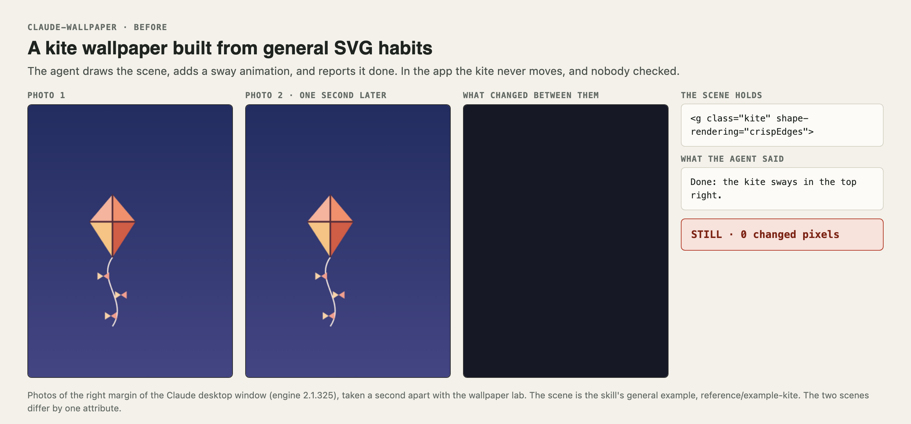
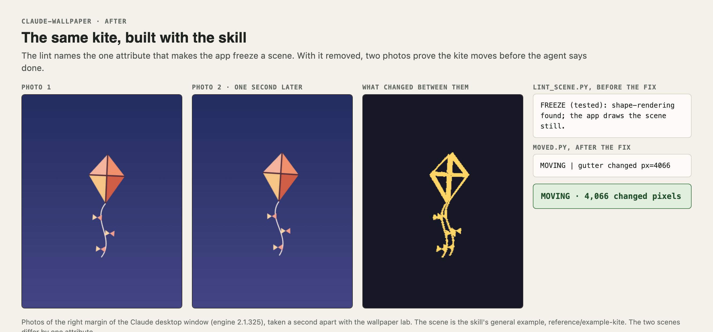

# claude-wallpaper

A wallpaper in the Claude desktop app is a mod that calls `$.theme.set({ colors, backdrop })` and answers the
`Backdrop` render with one SVG. The bundled `plugin-authoring` skill and its `look.md` say how to write that mod. This
skill adds what they don't: which SVG features make the app draw a scene **still**, how to test a scene **in the app
without a reload**, and how to **prove motion with photos**. Born 14 Nov 2026 from a theme that stayed frozen through
four rebuilds. Reference implementations: `reference/example-kite/` (ours), the open-source
`stillgbx/synthwave-claude`, and Anthropic's `plugins/theme-examples`.

## Rules the app enforces (tested on engine 2.1.325)

| Rule | How we know |
|---|---|
| `shape-rendering` anywhere in the scene, as a style rule or an attribute, even on something unused, makes the app draw the **whole scene still** | tested in isolation, three ways |
| Any media query except `prefers-reduced-motion` stills the scene | synthwave's changelog 0.1.1; matches our runs |
| SVG `<filter>` and `mix-blend-mode`: a scene holding them stayed still | seen, never isolated: treat as a risk |
| Raster pictures (`<image>`, `data:image`) draw nothing, and neither does a still `{ image }` ground | tested |
| `style="…"` attributes may be dropped: keep every style in the one `<style>` sheet | synthwave's note |
| A scene source is at most 131,072 characters | look.md |
| A session has **one theme and the last set wins**. Other theme mods may set theirs on every message | tested: see `reference/hold-the-look.md` |
| Light mode lays a pale veil over the text column. A glass `tint` is used only where the app's text reads on it, so a dark tint in light mode turns the window white | tested |
| A mod reloads only when the turn that edited it ends | plugin-authoring |
| The mods folder is named after the session id, which changes on a resume or a `/model` switch. Edits in the old folder silently stop loading | cost a turn |

Animate with CSS keyframes in the style sheet (no script, no SMIL), with px units in transforms. Patterns, masks,
gradients and clip paths are fine. Keep subjects in the margins: on a laptop window the chat column covers roughly
35–80 % of the width and the sidebar 0–15 %.

## Workflow

1. **Load `plugin-authoring`** and read its `look.md`. Note the mods folder it prints under WHERE TO WRITE IT.
2. **Show the end state first.** Render the scene in a browser, light and dark, and get the person's verdict before
   building the mod. Find earlier design picks before drawing new ones.
3. **Generate the scene from a script** that writes `hooks/scene.ts`, and never hand-edit the output. Run the lint
   in the generator and fail the build on a FREEZE line. `reference/example-kite/make_kite.py` is a small model.
4. **Install the lab** (below) and end the turn so it loads.
5. **Control first.** Show `reference/scenes/synthwave.svg`, photograph twice, run `moved.py`. It must say MOVING.
   If the control is STILL, the cause is the app or the window (hidden, covered, reduced motion), not your scene.
6. **Then your scene.** MOVING: go on. STILL: open the photo to check it shows your scene, then bisect (below).
7. **Wire the scene into the real mod**, end the turn, photograph the real thing once more.
8. **Take the lab out**: empty its tick file and delete its folder from the mods folder.
9. **Report with evidence**: the `moved.py` lines, and say what was not photographed.

## Commands

```bash
python3 ~/.claude/skills/claude-wallpaper/scripts/lint_scene.py <scene.svg | hooks/scene.ts>
```

```bash
~/.claude/skills/claude-wallpaper/scripts/install_lab.sh <mods folder> <project>/.wallpaper-lab
```

```bash
~/.claude/skills/claude-wallpaper/scripts/show.sh <project>/.wallpaper-lab <scene.svg> <word>
```

```bash
uv run -q --with pillow --with numpy python -I ~/.claude/skills/claude-wallpaper/scripts/moved.py a.png b.png
```

`show.sh <lab dir> --off` puts the app's own look back. `<word>` must be new each time (letters, digits, `-`, `_`).
An optional fourth argument to `show.sh` is a look, such as `'{"glass":{"blur":12,"opacity":0.34},"override":"dark"}'`.

## Photographing the window

- Use **cua-driver**: `list_windows` for the Claude app's pid and window id, then `get_window_state` with
  `max_elements: 1` and `screenshot_out_file`. computer-use cannot see the Claude app, and `screencapture` has no
  screen-recording permission. Never call cua-driver's `list_apps`: it returns thousands of tokens.
- The window must be on the visible desktop, or no photo is written. **Ask before bringing it forward.** Find the
  front app with `lsappinfo info -only name,pid "$(lsappinfo front)"`. If the person works on that display, ask for
  a minute of screen time and wait for their go.
- Two photos about a second apart are enough. For a timed animation, compare each photo's time (`stat`) with the
  draw time in `drawn.json` before reading the result.
- Never send a window photo anywhere or put it in a skill or README: it shows the sidebar. Crop to the wallpaper.

## Bisecting a frozen scene

The app stills a whole scene, so one bad line freezes everything, even a line no element uses.
1. Add the probe: copy the rule and the square from `reference/scenes/probe.svg`, and run `moved.py … --probe`.
   A frozen probe sits at its start.
2. Halve the scene: drop the art, then the definitions, then the style rules, one group per test.
3. When two halves both freeze, look for what they share.
4. Confirm both ways: only the suspect (STILL) and everything but the suspect (MOVING). Then fix the generator.

## QA checklist

- [ ] `lint_scene.py` ends `OK:` on the built scene.
- [ ] The control was MOVING in the same window, the same day.
- [ ] `moved.py` says MOVING on the real mod after its last reload, and the line is in the report.
- [ ] Looked at in both modes, or the theme is one-mode on purpose (`makeColors({ only: 'dark' })`).
- [ ] No other theme mod overwrites it on the next message (`reference/hold-the-look.md`).
- [ ] The lab is removed.

## Gotchas that cost a round

- Saying "the app can't animate" from one frozen scene. Test a known-moving control the same way first.
- Asking the person to watch each guess. Photograph it yourself and ask them to look once, at the end.
- A photo can catch the window between two themes. With `--probe`, `moved.py` says NO PROBE. Shoot again.
- Without crisp edges, pixel art is a touch softer. That is the price of motion.
- `prefers-color-scheme` inside a scene follows the app, but stills the scene. Make a dark and a light scene instead.

## Files

`scripts/lint_scene.py` · `scripts/moved.py` · `scripts/show.sh` · `scripts/install_lab.sh` ·
`reference/lab-mod/` (the live swap switch) · `reference/hold-the-look.md` · `reference/scenes/` (control, probe,
minimal, a frozen case, with what each did in the app) · `reference/example-kite/` (a general example and its generator).

## Before / after

The same kite wallpaper, without and with this skill. Each picture holds two photos of the Claude desktop window's
right margin, taken a second apart through the wallpaper lab, and the pixels that changed between them. The scene is
`reference/example-kite`; the two versions differ by one attribute. Sources are in `examples/`.




