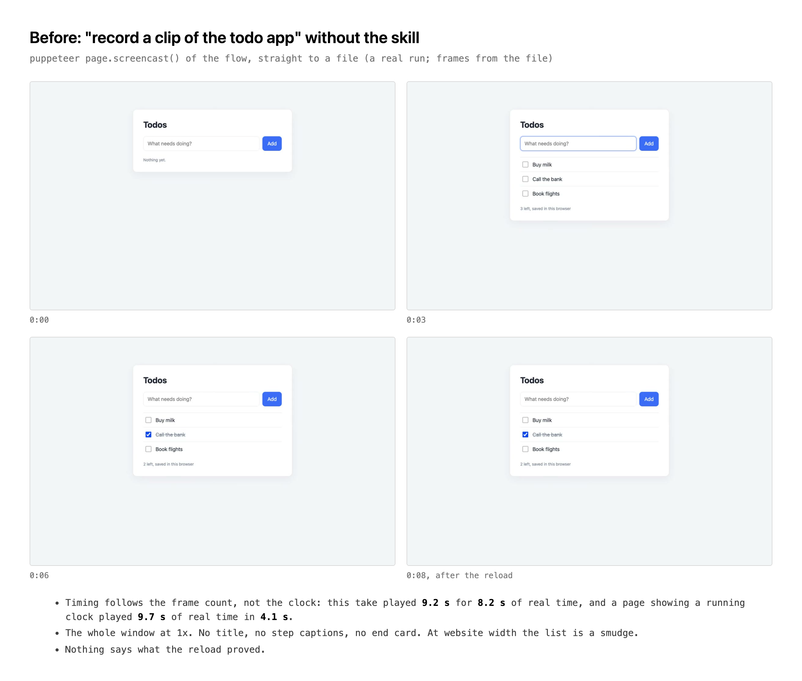
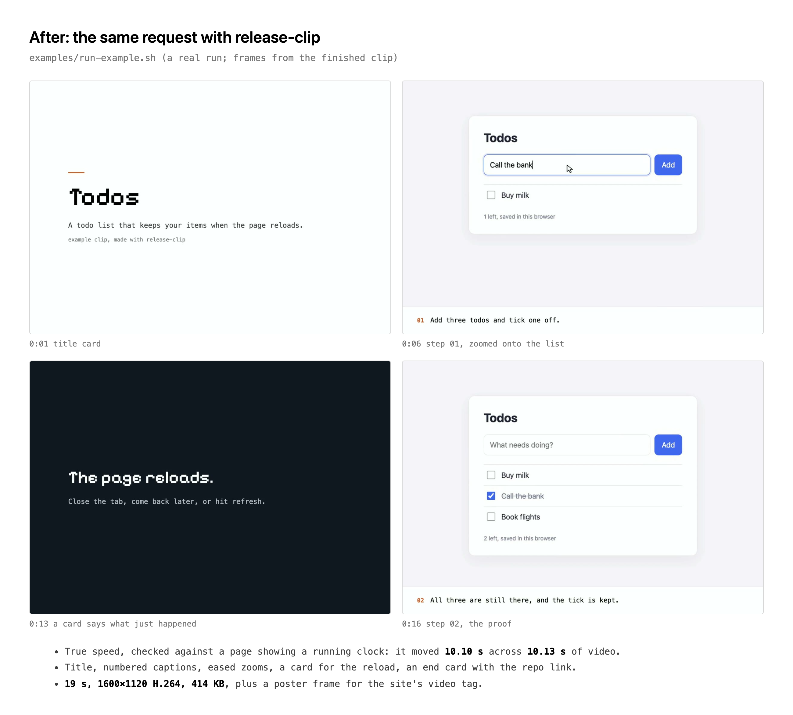

# release-clip

A release is easier to believe when people can watch it work. This skill films
the real feature in a headless Chrome. The pointer is drawn and every frame
keeps its real timestamp, so the clip plays at true speed. A plan file cuts the
takes into a short story: title card, takes with one-line numbered captions,
cards for the jumps a camera can't film, and an end card with the repo link.
Eased zooms make the important UI readable at website width. The result is
`demo.mp4` (H.264, faststart, silent), `demo-poster.png`, and a `demo.gif` for
READMEs, since GitHub won't play an mp4.

The self-test, `examples/run-example.sh`, films a small todo app from start to finish
and cuts it.

## Rules
- **Film the real thing, live.** No mockups and no stitched stills. If a moment can't be filmed (a window closing, a day passing), cut to a card that says so. Never fake the moment.
- **True speed.** `encode.py` prints video length against wall-clock length for every take, and the two must match. Trim dead time with `in`/`out`. Don't speed anything up; if you must, the caption says "sped up".
- **Story in 3–5 beats, 20–30 s.** Each caption says what the viewer sees, in plain words, in one line.
- **Zoom onto the proof** of each step: the toast, the list, the tab row. UI text at 1x is unreadable at 800 px.
- **Nothing private on screen.** Use neutral sample data in a throwaway folder. No real accounts, customer names, or paths you wouldn't publish.
- **Disclose any harness help in the hand-off.** For example, say if you copied state the test editor misplaced, and say what only a run in the real app can prove.
- **Deliver into the project:** `examples/demo.mp4`, `demo-poster.png` and `demo.gif`. In the README, put the GIF inline and link it to the mp4: ``. For a website, use `<video src="demo.mp4" poster="demo-poster.png" autoplay muted loop playsinline>`. Commit, and push once the owner has watched it.

## Workflow
1. **Plan the beats.** Copy `plan.example.json` next to the takes and write the cards and captions first.
2. **Build a throwaway stage**: a scratch folder and sample data. Append every path you create to a `cleanup-paths.txt`.
3. **Start the browser** in the background: `node browser.js 1280x800 2`. Its viewport is fixed for the whole session.
4. **Drive to the start state** with `step.js`, and check it with `step.js shot /tmp/x.png` between takes.
5. **For each beat:**
   - start `node record.js takes/A`;
   - drive it with `glide`/`glideto`, then `clickhere`, so viewers see the pointer move;
   - stop with `touch takes/A/STOP`;
   - run `python3 encode.py takes/A takes/A.mp4`.
6. **Contact-sheet each take** (`ffmpeg … tile=4x3`). Set `in`/`out`, the captions' `at` and the `zoom` keys in the plan.
7. **Cut:** `python3 compose.py plan.json` (it calls `cards.js` itself).
8. **QA** with the checklist below, then deliver, clean up only the logged paths, and hand over.

## Commands
| | |
|---|---|
| `node browser.js [WxH] [DPR]` | One headless Chrome on `CLIP_PORT` (default 9333), with a drawn pointer and a click ring. `CLIP_HIDE="sel"` hides overlays; `CLIP_PROFILE=dir` keeps the profile. |
| `node step.js goto URL [SEL]` | Plus `key`, `type`, `paste FILE`, `click SEL`, `clickxy`, `glide X Y [MS]`, `glideto SEL [TEXT] [MS]`, `clickhere`, `move`, `drag`, `waitfor JS [MS]`, `eval JS`, `center SEL [TEXT]`, `shot FILE`, `wait MS` |
| `node record.js DIR` | CDP screencast with per-frame timestamps; stop with `touch DIR/STOP` or SIGTERM. |
| `python3 encode.py DIR OUT.mp4` | Turns the frames into a true-speed 30 fps clip and prints video vs wall-clock length. |
| `node cards.js PLAN WORKDIR` | Only renders the cards and caption strips, for checking the look. |
| `python3 compose.py PLAN` | The whole cut, plus the poster. |

**Plan keys:** `width`, `ui_height`, `caption_height` (0 = no strip), `fade`,
`crf`, `out`, `poster`, `poster_at`, `gif`, `gif_width` (800), `gif_fps` (12), `theme` (colours + `font_file`), `number_captions`.
**Segments:** `{card:{title, lead, small, dark, big}, secs}` or
`{take, in, out, captions:[{text, at}], zoom:[[t, zoom, cx, cy], …]}`.
`t` is seconds into the segment, and `cx, cy` are the zoom centre as fractions
of the frame. Zoom eases between keys and clamps at the edges, so aim at the
thing itself. Takes resolve from the plan's folder.

## Targets
- **Web app:** a `file://` page, localhost, or a deployed URL.
- **VS Code or Cursor add-on:** film it in `code serve-web` running in the same browser. Follow `references/vscode-extension.md` (settings, close and reopen, Claude Code in the terminals).
- **Electron app:** launch it with `--remote-debugging-port=9333`. `record.js` and `step.js` attach to it; the drawn pointer only comes from `browser.js`, so inject it yourself or skip it.
- **Native app:** out of scope. Use a screen recorder instead (QuickTime, OBS).

## QA checklist
- [ ] Every take's encode line shows video length equal to wall-clock length. On a new machine or setup, film `examples/clock.html` for 10 s once. The clock readings in the first and last frames should differ by the video's length.
- [ ] The contact sheet at each caption change has the caption on the right frame, and each zoom shows the proof.
- [ ] Full-size frames are crisp: DPR 2, with no resize box and no stray selection or hover highlight.
- [ ] Cards report `font ok` and `fits`.
- [ ] Playback check in real Chrome: `autoplay muted loop playsinline` starts, loops, and isn't letterboxed.
- [ ] The mp4 is under about 5 MB, `yuv420p`, `color_range tv`; the GIF is under about 8 MB, with readable text at 800 px.
- [ ] No personal data in any frame: paths, peer names, account names.

## Gotchas that cost a round
- **`page.screencast()` stamps a fixed 25 fps, however many frames actually arrive**, so playback speed follows the frame count, not the clock. Filming a page that shows its own running clock (`examples/clock.html`), 9.66 s of real time played back in 4.08 s, 2.4x too fast. A light todo flow went the other way: 8.2 s came out as 9.2 s. With `record.js` + `encode.py`, the clock moved 10.10 s across 10.13 s of video.
- **ffconcat `duration` lines stretch frames under 40 ms**, which turned 12 s into 13.9 s. `encode.py` links a 30 fps sequence instead.
- **`page.screenshot` or `setViewport` during a take fires a resize.** A terminal then flashes its `cols x rows` box. Set the viewport once, and don't `shot` while recording.
- **Each `step.js` call is a new connection whose mouse starts at (0,0).** A bare mouse-down clicks the corner, so use `glide`/`glideto` and then `clickhere`.
- **In zsh, an unquoted `$XY` doesn't word-split.** Pass x and y as separate arguments.
- **Some ffmpeg builds (Homebrew's, for one) have no `drawtext`.** That's why the cards are HTML→PNG, which also gets real fonts.
- **JPEG frames are full-range.** Unnormalized segments shift brightness at each fade, which is why `compose.py` forces tv range.
- **ffmpeg colours must be `0xRRGGBB`, not `#fff`.** `compose.py` converts them.
- **GitHub's file view doesn't play an mp4.** It shows "View raw", which downloads the file (checked 2026-10-21). A README needs the GIF, which plays inline (also checked), or an mp4 dragged into GitHub's web editor, which hosts it as an attachment. A 26 s clip makes a 4.5 MB GIF at 800 px and 12 fps.
- **Your site:** copy the mp4 and poster into the site repo. Never hotlink `raw.githubusercontent.com`, which serves plain downloads.

## Files
`lib.js` (finds puppeteer and Chrome) · `browser.js` · `step.js` · `record.js`
· `encode.py` · `cards.js` · `compose.py` · `plan.example.json` ·
`fonts/` (Pixelify Sans, OFL) · `references/vscode-extension.md` ·
`examples/` (todo app, `plan.json`, `run-example.sh`, `clock.html` for the speed check, before/after pages and PNGs).
Needs node with puppeteer (found via `PUPPETEER_PATH`, local, or global npm),
Chrome, python3 and ffmpeg.

## Before / after

The same request, "record a clip of the todo app", without and with the skill.
Both are real runs on `examples/todo-app`. Before is puppeteer `page.screencast()`
straight to a file; after is `examples/run-example.sh`. The frames come from the
output videos.

