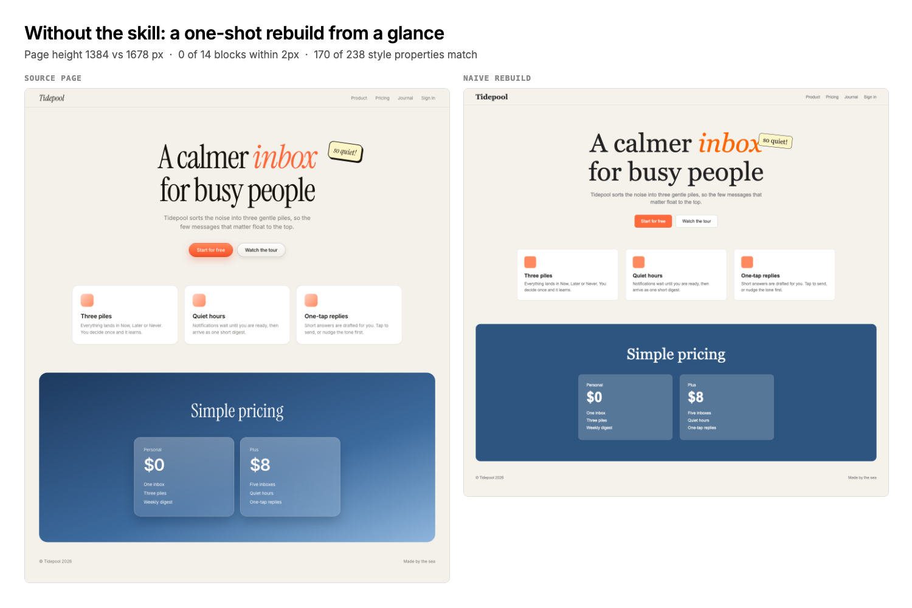
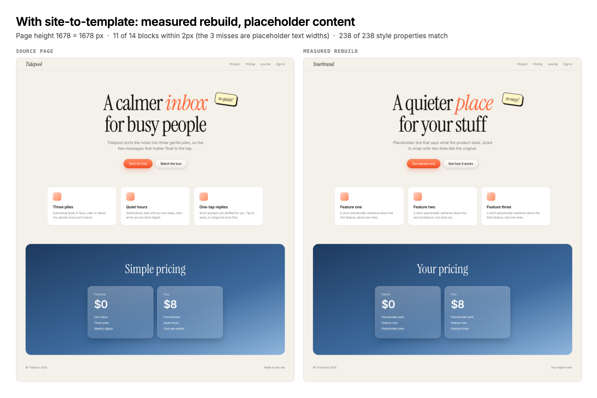

# site-to-template

A rebuild from a glance gets the vibe and misses every number: fonts fall
back, spacing drifts, shadows flatten, and the fun parts (drag, hover pills,
typing bubbles, rolling prices) never get noticed. This skill measures the
source page, rebuilds it section by section from those numbers, and proves
fidelity with diffs. The reference run is in `examples/`: a source page, a
naive rebuild, and a measured rebuild, with the numbers each one scores.

## The content boundary (hard rule, read first)

- **Replicate:** layout, spacing, type scale, color, radii, shadows, gradients,
  glass, motion timing, interaction behavior.
- **Never copy:** the source's copy text, photos, videos, logos or wordmarks,
  real people's names, avatars or testimonials, audio, or recognizable
  third-party characters (cartoon, game, film), even "with small changes".
  Every slot gets original placeholder copy of similar length and original
  art (generated or drawn) at the same size and position.
- **Fonts:** load the same families from an open source (Google Fonts). Never
  ship the site's own hashed font files.
- **Brand:** a template that still says the source's name, or ships unchanged
  under a public URL, reads as a knockoff. Keep it local or unlisted until
  the user's own brand and content are in.
- **Research dumps quote the source.** Keep `outline.txt`, token dumps and
  any file with their text out of git (`.gitignore` them before the first
  commit). Box-only geometry JSON and the scripts are fine to keep.

## Setup (once)

```sh
cd <skill>/scripts && npm i && npx playwright install chromium
```
`playwright` is pinned in `package.json`; a newer one needs a new browser
download (`browserType.launch: Executable doesn't exist` means run the install).

## Workflow

**0. Preflight.** A public URL needs no login: headless Playwright is the
channel. If the page is behind auth, drive the user's real browser instead.

**1. Fetch and outline.** `curl` the HTML and CSS into a scratch folder.
List the fonts (`@font-face`), the section tags, and every class name
(strip `<script>`/`<svg>` first). Name the sections in flow order.

**2. Name the deliverable and done-state** before writing markup, e.g.
"`index.html`; page height equal at 1440 and 393; landmark boxes within
±2px; style diff clean except intended asset swaps". Commit per variant.

**3. Tokens.** Write `config.json` with ~40–60 landmark selectors (see
`examples/config.example.json`), then at desktop and phone width:
`node scripts/dump.mjs <url> tokens-1440.json 1440 900 config.json ref`

**4. Settled geometry.** `node scripts/geo.mjs <url> geo-ref-1440.json 1440 900 config.json ref`
scrolls each landmark to the centre and waits, so reveal animations and
lazy content are measured in their final state. Repeat at 393×852.

**5. Build in flow order** from the measured numbers: tokens as CSS
variables, section skeletons at the measured heights until the page height
matches, then fill each section. Absolute tops on desktop are fine if the
source uses them; switch to flow with measured heights for phones.

**6. Diff geometry.** Same `geo.mjs` on the clone with `side=clone` (the
config `map` renames selectors when your class names differ), then
`python3 scripts/cmp.py geo-ref.json geo-clone.json`. Fix every OFF that
isn't a placeholder-text width.

**7. Diff styles.** `dump.mjs` on the clone, then
`python3 scripts/sdiff.py tokens-ref.json tokens-clone.json`. Don't call the
styles "exact" until this is clean, apart from asset `url()`s and
same-look-different-structure cases you can name.

**8. Look.** `node scripts/sections.mjs sections.json && python3 scripts/sbs.py sec`
gives matched viewport screenshots per section, with the same scroll and
the same settle time. Read every pair. Boxes miss shadows, gradients and texture.

**9. Interactions.** `node scripts/interactions.mjs <url>` lists every element
with listeners (pointerdown/drag, hover, click, scroll, media). Click through
each one on the source (Playwright + screenshots) to see what it does, then
rebuild it with original content. Typical finds: draggable stickers, hover
pills, pop-up windows, video scrubbers, rolling price digits, footer eggs.

**10. Motion.** Never assume motion; sample it with
`node scripts/motion.mjs <url> motion.json`: text length and size every 300ms
(typing bubbles), and transform across a scroll sweep (a marquee that looks
animated may be scroll-linked and static otherwise; parallax has a measurable
rate). Rebuild on the sampled timings.

**11. Test.** Copy `scripts/itest.template.mjs`, add one check per interaction,
run it against the clone. Zero console errors is part of the bar.

**12. Phone pass**, then commit and hand over the one command that opens it.

## Gotchas that each cost a round

- **Full-page screenshots lie.** Resizing to full height replays reveals and
  catches them mid-flight. Compare settled geometry and viewport shots.
- **Reveal toggles.** An IntersectionObserver that removes `.in` on exit
  blanks sections in captures. Reveal once and unobserve.
- **Parallax skews measurement.** Sample the transform at several scroll
  positions, fit the rate, and back the offset out of your base positions.
- **Hidden overlays swallow clicks.** `display:grid` on a modal beats the
  `hidden` attribute. Add `[hidden]{display:none}` for every overlay.
- **Full-width absolute boxes block what's under them.** A centred headline
  wrapper spanning the hero eats clicks on stickers. Use `pointer-events:none`
  on the wrapper and `auto` on its children.
- **Duplicate ids overwrite sections.** A script filling `#faq` wrote into the
  section instead of the list once both carried that id.
- **Headless Chromium can't decode H.264.** "Missing" stickers or windows in
  captures may be mp4s that render fine in real Chrome. Check the DOM.
- **Transforms scale boxes.** A reveal `scale(.965)` makes rect widths 3.5%
  small. Read CSS `width` from the token dump, not the rect.
- **Liquid glass** is `backdrop-filter: url(#svg-filter)`, which only works in
  Chromium. Feature-detect it and keep a `blur()` fallback.

## Files

`scripts/` — `shoot.mjs` (full page) · `dump.mjs` (computed styles) ·
`geo.mjs` (settled boxes) · `cmp.py` (box diff) · `sdiff.py` (style diff) ·
`sections.mjs` + `sbs.py` (matched section shots) · `interactions.mjs` (CDP
listener inventory) · `motion.mjs` (time and scroll sampling) ·
`itest.template.mjs` (interaction test) · `_lib.mjs` · `package.json`.
`examples/` — `reference/` (source page authored for the example), `before/`
(naive rebuild), `after/` (measured rebuild), `config.example.json`,
`make-pair.mjs`, `before.png`, `after.png`.

## Before / after

Same source page, rebuilt once from a glance and once with this workflow.
The numbers come from `cmp.py` and `sdiff.py` run on the three example pages.




